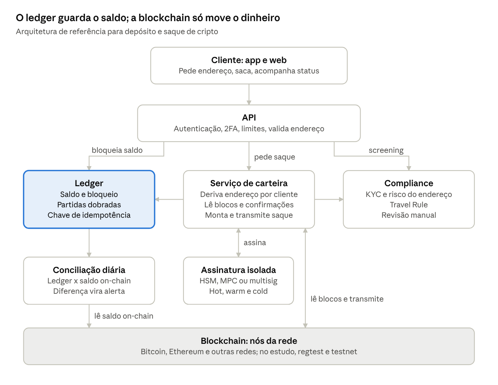
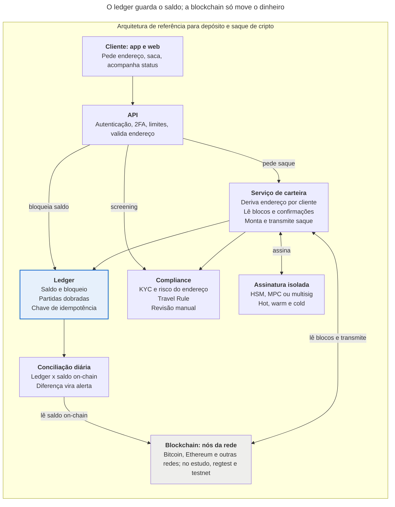

# Guia de estudo: depósito e saque de cripto numa exchange

## Objetivo do estudo

O desafio é projetar e construir, em ambiente de teste, um sistema que receba cripto de fora (depósito, ou *wallet in*) e envie cripto para fora (saque, ou *wallet out*) em nome de clientes de uma plataforma custodiante, como uma exchange.

O guia descreve uma arquitetura de referência genérica, montada com conceitos públicos de mercado. Não descreve a implementação de nenhuma empresa. Cada grupo deve pesquisar, escolher e justificar a própria stack.

Como usar: leiam os conceitos, discutam a arquitetura, implementem os dois fluxos numa testnet e respondam às perguntas da última seção no relatório.

## Conceitos de base

Antes de desenhar, o grupo precisa dominar estes termos. Cada um vira uma decisão de projeto.

| Conceito | O que é | Por que importa no projeto |
| --- | --- | --- |
| Chave privada e endereço | A chave assina transações; o endereço é derivado dela e recebe fundos | Quem guarda a chave controla o dinheiro |
| Carteira HD (BIP-32/44) | Uma semente gera infinitos endereços de forma determinística | Permite um endereço de depósito por cliente sem guardar milhares de chaves |
| Modelo UTXO x modelo de conta | Bitcoin gasta "moedas" anteriores; Ethereum debita saldo de uma conta | Muda como se detecta depósito e como se monta o saque |
| Token | Ativo emitido por contrato (ERC-20, SPL) sobre uma rede | O depósito aparece como evento do contrato, não como transferência nativa |
| Confirmação e finalidade | Número de blocos após a transação até ela ser considerada definitiva | Creditar cedo demais expõe a plataforma a reversão |
| Taxa de rede (gas) | Custo pago aos validadores para incluir a transação | Precisa ser estimada, cobrada do cliente ou absorvida |
| Memo / destination tag | Campo extra que identifica o cliente em redes de endereço compartilhado (XRP, XLM) | Sem ele o depósito chega sem dono |
| Custódia hot, warm e cold | Hot fica online e assina na hora; cold fica offline; warm é intermediária | Equilíbrio entre velocidade de saque e risco de roubo |
| Ledger interno x saldo on-chain | O sistema registra o saldo de cada cliente internamente; on-chain só existe o saldo agregado das carteiras da plataforma | Os dois precisam bater todos os dias (conciliação) |
| Omnibus x segregada | Fundos de todos os clientes numa carteira só, ou uma carteira por cliente | Afeta custo de taxa, conciliação e exigência regulatória |

## Arquitetura de referência

A regra central: o saldo do cliente vive no ledger interno, e a blockchain só é tocada pelo serviço de carteira.

<!-- No PDF original, o diagrama abaixo é uma imagem. Ela foi extraída sem alterações para o arquivo guia_arquitetura_de_referencia.png; o bloco Mermaid em seguida transcreve o mesmo diagrama (textos, caixas e setas) para que o conteúdo também exista em texto. -->

arquitetura de referência · 8 componentes

O cliente fala só com a API. O serviço de carteira é o único que lê a rede e transmite transações, e pede a assinatura a um módulo isolado. Depósito confirmado passa por compliance antes de virar crédito no ledger. Notificação e dados consomem os eventos do ledger por uma fila e ficaram fora do desenho.

## Fluxo de depósito (wallet in)

O depósito é passivo: a plataforma não inicia nada, ela observa a rede e reage. O crédito ao cliente só acontece depois da finalidade e da checagem de compliance.

1. O cliente pede um endereço de depósito para um ativo e uma rede. O serviço de carteira deriva um endereço novo (ou devolve o existente) e o associa ao cliente.
2. O cliente envia a cripto de outra carteira ou exchange para esse endereço.
3. O observador de blocos lê cada bloco novo e procura transações (ou eventos de contrato, no caso de token) que tenham um endereço da plataforma como destino.
4. A transação entra como **detectada**, com hash, rede, valor, endereço de origem e número de confirmações.
5. A cada bloco novo o contador de confirmações sobe. Ao atingir o mínimo definido para a rede, o depósito passa a **confirmado**.
6. Compliance analisa o endereço de origem (screening de risco) e, se a regulação exigir, pede ao cliente os dados de quem enviou (Travel Rule). O depósito pode ficar **retido** até isso ser resolvido.
7. Liberado, o ledger lança o crédito no saldo do cliente, com uma chave de idempotência derivada de rede + hash + índice da saída.
8. O sistema notifica o cliente (push, e-mail) e publica o evento para dados e conciliação.
9. Periodicamente, os fundos dos endereços de depósito são varridos (*sweep*) para a carteira central, e o excedente da hot vai para a cold.

Estados sugeridos: `DETECTADO` → `CONFIRMANDO` → `EM_ANALISE` → `CREDITADO`, com `RETIDO` e `REJEITADO` como desvios.

## Fluxo de saque (wallet out)

O saque é o fluxo de maior risco: um erro tira dinheiro da plataforma de forma irreversível. Por isso o saldo do cliente é bloqueado antes de qualquer assinatura, e cada etapa tem uma trava.

1. O cliente informa ativo, rede, endereço de destino, valor e, se a rede pedir, o memo.
2. A API valida o formato do endereço para a rede escolhida (checksum, prefixo) e se a rede está ativa para saque.
3. O sistema confere autenticação forte (2FA), limites do cliente e saldo disponível, e calcula a taxa.
4. O ledger **bloqueia** valor + taxa no saldo do cliente, numa operação atômica com chave de idempotência. A partir daqui o dinheiro não pode ser usado em outra operação.
5. Compliance faz o screening do endereço de destino e, se exigido, coleta os dados do beneficiário (Travel Rule). Valores altos ou endereços novos podem cair em revisão manual.
6. O serviço de carteira monta a transação (seleção de UTXO ou nonce, estimativa de gas) e a envia ao módulo de assinatura. Assinatura nunca acontece no mesmo processo que recebe a requisição do cliente.
7. A transação assinada é transmitida (*broadcast*) ao nó. O saque passa a **enviado**, com o hash.
8. O observador acompanha as confirmações. Confirmado, o ledger converte o bloqueio em débito definitivo e notifica o cliente.
9. Se a transação falhar ou ficar presa (taxa baixa), o sistema decide entre acelerar (RBF, substituir nonce) ou cancelar e desbloquear o saldo.

Estados sugeridos: `SOLICITADO` → `BLOQUEADO` → `EM_ANALISE` → `ASSINADO` → `ENVIADO` → `CONFIRMADO`, com `CANCELADO` e `FALHOU` como desvios. Um saque cancelado precisa devolver o saldo exatamente uma vez.

## Compliance e segurança

Uma exchange regulada não pode tratar depósito e saque só como transferência técnica. Cada controle abaixo vira um passo do fluxo e um estado possível.

| Controle | O que faz | Onde entra |
| --- | --- | --- |
| KYC | Identifica o cliente antes de ele movimentar | Antes de gerar endereço e antes do primeiro saque |
| Screening de endereço (KYT) | Pontua o risco do endereço de origem ou destino com base em histórico on-chain | Depósito confirmado e saque bloqueado |
| Travel Rule | Troca dados de remetente e beneficiário entre prestadoras de serviço, como numa transferência bancária | Depósito e saque acima do limite que a norma definir |
| Limites | Teto por operação, por dia e por perfil de cliente | Antes do bloqueio de saldo no saque |
| 2FA | Segundo fator na hora de sacar | Antes do bloqueio de saldo no saque |
| Lista de endereços confiáveis | Cliente cadastra destinos com antecedência; endereço novo pode ter carência | Validação do saque |
| Revisão manual | Fila para analista aprovar casos fora do padrão | Saque de valor alto ou com alerta de risco |
| Segregação de chaves | Assinatura em módulo isolado (HSM, MPC ou multisig), com quórum para a cold | Módulo de assinatura |

A Travel Rule nasce de uma recomendação internacional do GAFI/FATF. Cada país define valores e prazos; o grupo deve pesquisar a norma vigente no Brasil e citar a fonte, sem supor números.

## Problemas difíceis que o projeto deve resolver

Estes são os pontos em que um sistema ingênuo perde dinheiro. A avaliação do projeto deveria olhar principalmente para eles.

- **Idempotência.** O observador pode ver o mesmo bloco duas vezes, e a API pode receber o mesmo pedido de saque duas vezes. Crédito e débito precisam de chave única para nunca acontecerem em dobro.
- **Reorganização de cadeia (reorg).** Um bloco já visto pode ser descartado pela rede. O depósito detectado nele precisa voltar a pendente, e nada pode ter sido creditado antes da finalidade.
- **Finalidade por rede.** Cada rede tem seu critério: número de blocos em Bitcoin, checkpoint finalizado em Ethereum. O mínimo de confirmações é configuração por rede, nunca constante no código.
- **Concorrência no saldo.** Dois saques simultâneos não podem gastar o mesmo saldo. Usar transação de banco com bloqueio ou um ledger de partidas dobradas.
- **Nonce e UTXO.** Em redes de conta, dois saques com o mesmo nonce se anulam; em UTXO, duas transações não podem gastar a mesma saída.
- **Transação presa.** Taxa estimada baixa demais deixa o saque parado. O sistema precisa acelerar ou cancelar com segurança.
- **Depósito sem dono.** Memo esquecido, rede errada (enviar um token pela rede errada) ou ativo não suportado. Definir o que acontece: fila de recuperação manual, devolução ou perda.
- **Conciliação.** Todo dia, a soma dos saldos de clientes no ledger tem de bater com o saldo on-chain das carteiras da plataforma, menos o que está em trânsito. Diferença vira alerta.
- **Endereço envenenado.** Golpista envia valor zero de um endereço parecido para o cliente copiar o endereço errado do histórico. Pensar em como a interface reduz esse risco.

## Opções de stack para o projeto

Tudo abaixo roda de graça e em rede de teste, sem dinheiro real. A escolha é do grupo; o relatório deve justificar cada uma.

| Camada | Opções abertas ou gratuitas | Referência de mercado para citar |
| --- | --- | --- |
| Rede local e testnet | Bitcoin Core em modo regtest ou testnet; Anvil (Foundry) ou Hardhat para Ethereum local; testnet Sepolia | Provedores de nó como serviço (Alchemy, Infura, QuickNode) |
| Biblioteca de cadeia | bitcoinjs-lib ou python-bitcoinlib; ethers.js, viem ou web3.py | — |
| Backend e API | TypeScript (NestJS), Python (FastAPI), Go, Rust ou Java/Kotlin (Spring) | — |
| Banco e ledger | PostgreSQL com transações e tabela de lançamentos em partidas dobradas | Ledgers dedicados (TigerBeetle, Formance) |
| Filas e eventos | Kafka, NATS ou Redis Streams | — |
| Chaves e assinatura | Keystore criptografado com senha (só para estudo); SoftHSM para simular HSM; multisig nativo da rede | Custódia MPC e HSM comercial (Fireblocks, BitGo, AWS CloudHSM) |
| Compliance | Lista de bloqueio própria e regras simples de risco | Ferramentas de KYT (Chainalysis, Elliptic, TRM Labs) |
| Observabilidade | Prometheus + Grafana, logs estruturados | — |
| Infra | Docker Compose para subir tudo junto | Kubernetes em nuvem |

Nunca usem chave de mainnet nem fundo real. Para o projeto, uma semente de teste e moedas de faucet bastam.

## Roteiro do projeto

O projeto cabe em seis etapas, cada uma com uma entrega que dá para demonstrar. A ordem importa: o ledger vem antes da blockchain, porque é ele que protege o dinheiro.

| Etapa | O que construir | Entrega demonstrável |
| --- | --- | --- |
| 1. Ledger | Contas de cliente, lançamentos em partidas dobradas, bloqueio e desbloqueio de saldo, chave de idempotência | Teste que dispara dois débitos simultâneos e só um passa |
| 2. Endereços | Carteira HD que deriva um endereço por cliente numa rede local | Cliente pede endereço e recebe sempre o mesmo |
| 3. Depósito | Observador de blocos, contador de confirmações, crédito no ledger | Envio na regtest aparece creditado após N blocos |
| 4. Saque | API com validação, bloqueio, assinatura em módulo separado, broadcast e confirmação | Saque sai da plataforma e o saldo fecha |
| 5. Falhas | Reorg simulado, pedido duplicado, transação presa, rede errada | Cada caso com teste automatizado e resultado esperado |
| 6. Conciliação e compliance | Relatório diário ledger x on-chain, screening por lista de bloqueio, limite e 2FA | Diferença forçada gera alerta; endereço bloqueado barra o saque |

Entregáveis finais sugeridos: diagrama de arquitetura, diagrama de estados dos dois fluxos, código com testes, vídeo curto de demonstração e relatório respondendo às perguntas da próxima seção.

## Perguntas para o relatório

O relatório vale mais pelas decisões justificadas do que pela quantidade de código.

1. Quantas confirmações vocês exigem em cada rede, e por quê? Qual o risco se o número for menor?
2. Carteira omnibus ou segregada? Quanto custa em taxa varrer os endereços de depósito?
3. Que fração dos fundos fica na hot wallet? Como a cold é reabastecida e quem aprova?
4. Como o sistema garante que um mesmo depósito nunca é creditado duas vezes, mesmo com reinício do observador?
5. O que acontece com um saque se o nó cair depois da assinatura e antes da confirmação?
6. Como a conciliação trata valores em trânsito?
7. Onde fica a chave privada, quem tem acesso e como o grupo provaria isso a um auditor?
8. Que dados a Travel Rule exige no Brasil hoje e em que valor ela começa a valer? Citem a norma.

## Referências para começar

Pontos de partida públicos; o grupo deve ler a fonte e conferir se ainda está atual.

- [BIP-32: carteiras hierárquicas determinísticas](https://github.com/bitcoin/bips/blob/master/bip-0032.mediawiki)
- [BIP-44: estrutura de derivação multi-moeda](https://github.com/bitcoin/bips/blob/master/bip-0044.mediawiki)
- [Bitcoin Developer Guide](https://developer.bitcoin.org/devguide/)
- [Documentação para desenvolvedores do Ethereum](https://ethereum.org/en/developers/docs/)
- [GAFI/FATF: orientação sobre ativos virtuais e prestadoras de serviço](https://www.fatf-gafi.org/)
- Normas do Banco Central do Brasil para prestadoras de serviços de ativos virtuais, no site do BCB
