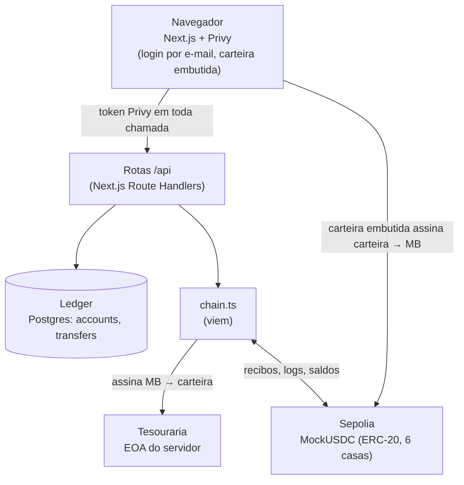
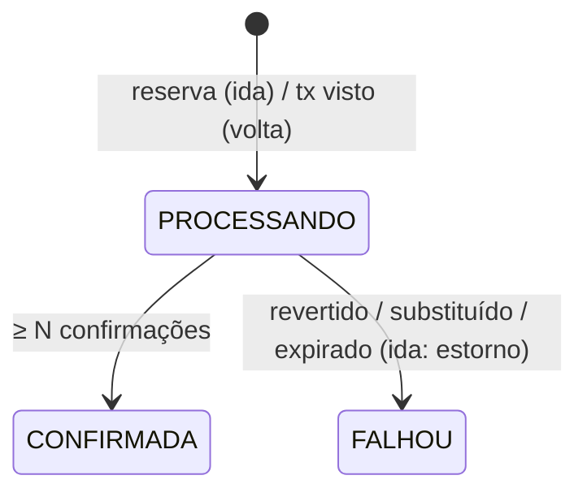

# Arquitetura

Princípio central (do guia de referência): **o ledger guarda o saldo; a blockchain só move o dinheiro.** O saldo custodial vive no Postgres; só o módulo `chain.ts` toca a rede.

## Componentes



| Peça | Papel |
|---|---|
| `src/lib/money.ts` | Parse, truncamento e formatação de valores. Tudo `bigint`: centavos no ledger, micro-unidades (6 casas) no token. |
| `src/lib/ledger.ts` | Operações atômicas do saldo: reservar, baixar, estornar, creditar. Cada uma condicionada ao estado no próprio `UPDATE`. |
| `src/lib/chain.ts` | Único acesso à rede: assina txs da tesouraria, lê recibos, nonces, saldos e eventos, envia cancelamentos. |
| `src/lib/transfers.ts` | Orquestra ledger + cadeia: cria transferências, `advance()` (confirmação preguiçosa), `creditInbound()`, `scanInbound()`. |
| `src/lib/reconcile.ts` | Invariantes de saldo por conta e da tesouraria. |
| `src/lib/deps.ts` | Dependências injetadas nos handlers (banco, verificador Privy, cadeia, config); os testes trocam por versões falsas. |

Não há worker nem indexador: a confirmação avança quando a tela consulta o status (`GET /api/transfers/:id`), e a varredura de entradas roda no `GET /api/me`.

## Modelo de dados

- **`accounts`**: `available_cents`, `reserved_cents`, `excess_micro` (sobra abaixo de 1 centavo), `initial_micro`, `wallet_address` (único), `last_scanned_block`. `CHECK` impede saldo negativo.
- **`transfers`**: `direction`, `amount_micro`, `status` (`PROCESSANDO` → `CONFIRMADA` | `FALHOU`), `tx_hash` **único** (RNF-02), `client_request_id` **único** (duplo clique), `nonce` e `raw_tx` (só na ida), `expires_at`, `failure_reason`.

## Fluxo Conta MB → carteira

```mermaid
sequenceDiagram
    participant U as Navegador
    participant A as /api/transfers
    participant DB as Ledger
    participant N as Sepolia
    U->>A: POST {MB_TO_WALLET, valor, clientRequestId}
    A->>DB: BEGIN; lock da tesouraria; reserva (available ≥ x)
    A->>A: assina transfer (nonce = max(pending, maior nonce no banco + 1))
    A->>DB: grava hash, nonce, raw_tx; COMMIT
    A->>N: broadcast
    loop a cada 3 s
        U->>A: GET /api/transfers/:id → advance()
        A->>N: recibo / nonce
    end
    A->>DB: ≥ N confirmações: baixa a reserva (CONFIRMADA)
```

`advance()` para a ida:

| Situação na rede | Ação |
|---|---|
| Minerado com sucesso, ≥ `CONFIRMATIONS` | `settleOutbound`: baixa a reserva |
| Minerado e revertido, ≥ `CONFIRMATIONS` | `refundOutbound`: devolve ao disponível |
| Nó não conhece o tx | Retransmite o `raw_tx` gravado |
| Sem recibo e nonce já consumido por outro tx | Estorna: o nosso nunca vai minerar |
| Sem recibo e `expires_at` vencido | Envia cancelamento (mesmo nonce, 0 ETH para si, taxa ≥ 130%); estorna quando o nonce for consumido |

## Fluxo carteira → Conta MB

1. A carteira embutida assina `transfer(tesouraria, valor)` no navegador, sem pop-up (`showWalletUIs: false`).
2. `POST /api/transfers {WALLET_TO_MB, txHash}`: o servidor só aceita um tx visível na rede, **enviado pela carteira desta conta para a tesouraria**.
3. `creditInbound()`: com ≥ `CONFIRMATIONS`, credita **o valor do evento `Transfer` do recibo**. Revertido → `FALHOU`, sem mexer no ledger. Não há crédito otimista.
4. Recuperação: `scanInbound()` lê os eventos `Transfer(carteira → tesouraria)` desde `last_scanned_block` e chama a mesma `creditInbound()`. Cobre quem fechou a aba antes de avisar o servidor.

## Estados



## Reconciliação

Em micro-unidades, depois de fechar tudo o que já tem confirmações suficientes:

- **Por conta:** `custodial + carteira + entradas_em_trânsito − saídas_em_trânsito = inicial`
- **Tesouraria:** `on-chain = Σ custodial + entradas_em_trânsito − saídas_em_trânsito`

"Em trânsito" quer dizer já minerado e ainda sem `CONFIRMATIONS`: uma entrada que saiu da carteira e ainda não foi creditada, ou uma saída que já chegou à carteira e ainda está reservada. `npm run reconcile` sai com código 1 se houver diferença.

## Decisões

| Decisão | Motivo | Alternativa descartada |
|---|---|---|
| Um só app Next.js, sem worker | Enxuto: uma conta demo não precisa de fila | Serviço de carteira separado + indexador |
| Regras de saldo no banco (`CHECK`, `UNIQUE`, `UPDATE … WHERE`) | A garantia vale mesmo com bug na aplicação ou concorrência | Lock na aplicação |
| Hash gravado antes do broadcast | Se o processo cair, o tx pode ser retransmitido e acompanhado | Gravar o hash depois de enviar |
| Nonce `max(pending, banco + 1)` sob lock consultivo | Um tx assinado e commitado, mas ainda não transmitido, não aparece no `pending` do nó | Só `pending` do nó (gera nonce duplicado) |
| Endereço da carteira vem da Privy, não do cliente | Impede direcionar fundos para endereço externo (fora do escopo) | Aceitar o endereço enviado pelo navegador |
| Valor creditado vem do evento on-chain | O cliente não decide quanto é creditado | Confiar no valor informado |
| `CONFIRMATIONS = 2` (configurável) | A finalização da Sepolia leva ~13 min, inviável no Demo Day | `finalized` |
| `accounts` + `transfers` em vez de partidas dobradas | Dão as garantias pedidas com menos peças | Ledger de partidas dobradas completo |
| Testes de cadeia no Anvil | Determinístico, rápido, sem credenciais | Testes contra a Sepolia |
